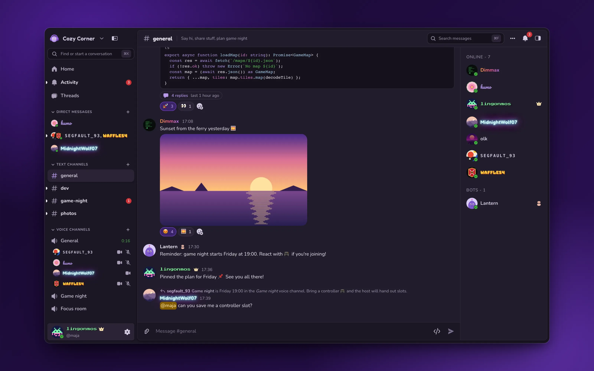
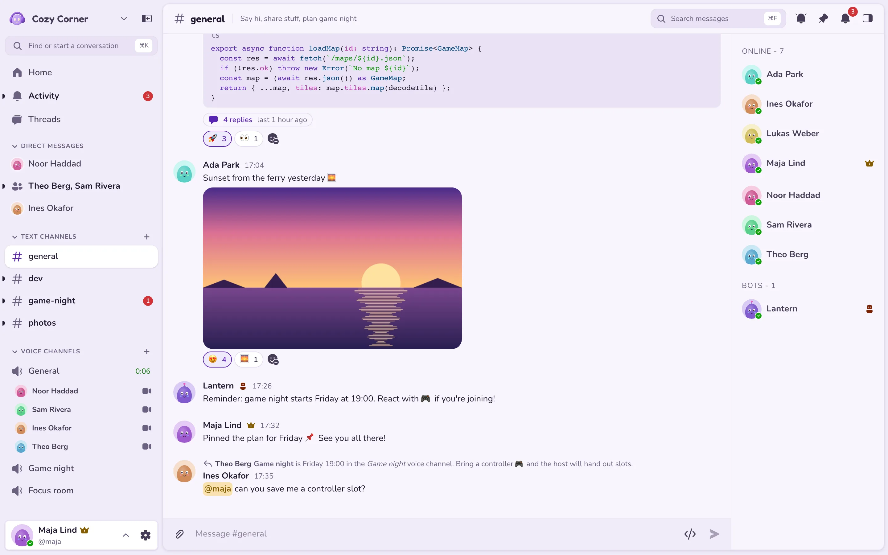
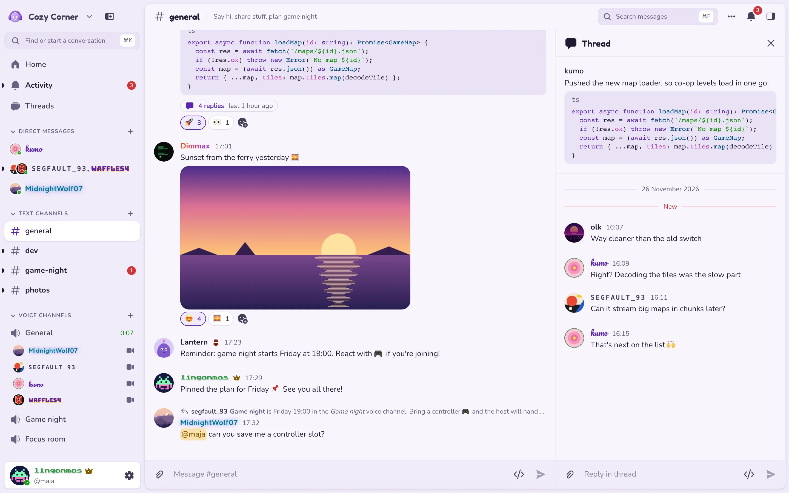
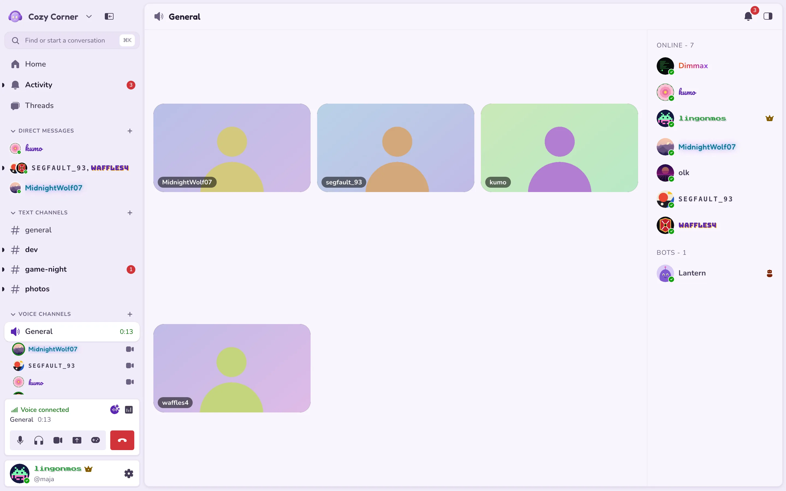
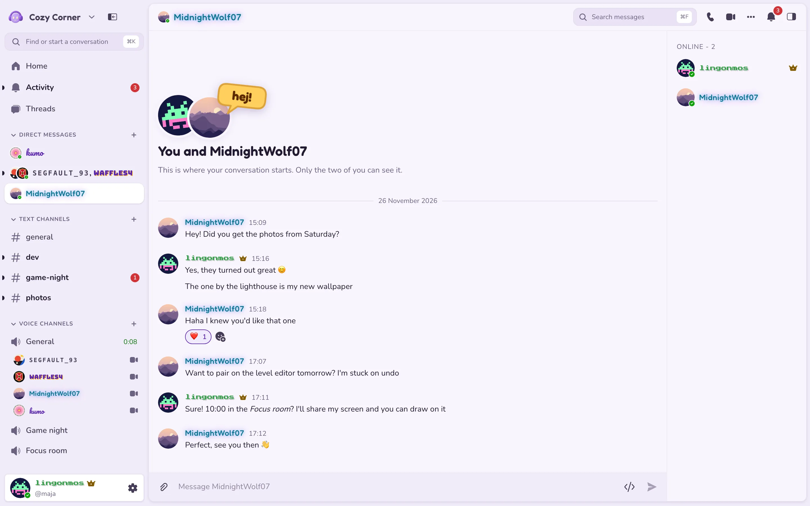
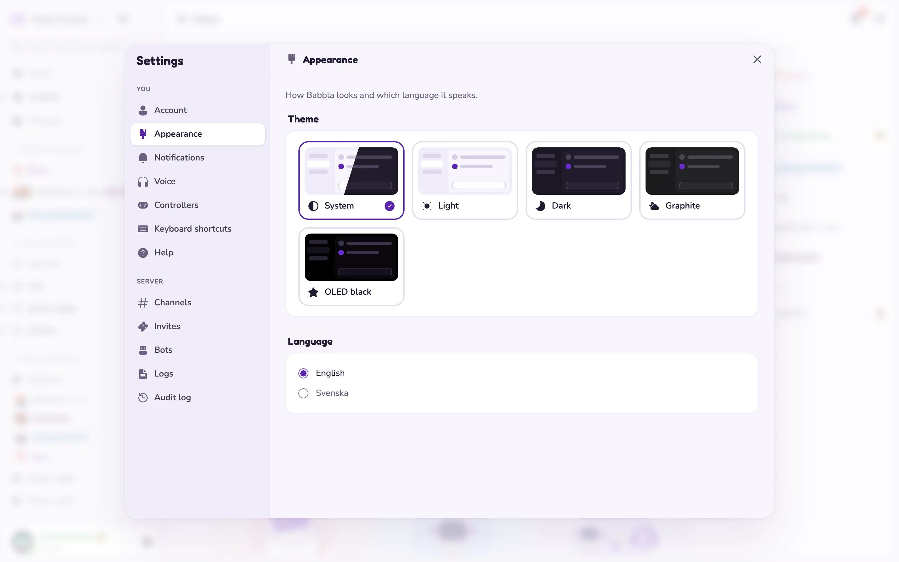

# Babbla

<p align="center"></p>

**Your own place to hang out.** Babbla is chat and voice for a group of friends, a club or a team, on a server you run yourself. Text channels, voice channels, direct messages, screen sharing and even co-op gaming over the internet, all in one friendly app. No ads, no tracking, and the data stays with you.

<p align="center">
  <a href="https://github.com/nikteg/babbla-releases/releases/latest"><b>Download the latest release</b></a>
  &nbsp;–&nbsp; macOS, Windows and Linux
</p>

## What you get

- **Chat that feels good to use.** Channels in categories, markdown and code, pictures and video, link previews, reactions, replies, pins, threads and search.
- **Drop-in voice.** Click a voice channel and you are in. Push to talk, per-person volume, noise suppression and cameras.
- **Share your screen, and draw on it.** Point things out with strokes that show up right on the sharer's screen.
- **Play together from afar.** Share a game and hand out controller slots: your friends' gamepads drive it as if they were on your couch.
- **Direct messages and calls**, one to one or in a group, with ringing on every device.
- **Never miss a thing.** Mentions, replies and DMs in one inbox, as system notifications and as push on your phone.
- **Make it yours.** Five themes in light and dark, name styles, profile pictures, English and Swedish.
- **Bring your bots and AI agents.** Bot accounts, API keys and a built-in MCP server let scripts and assistants take part like anyone else.

## Screenshots

Shown in your theme (light or dark).

<picture>
  <source media="(prefers-color-scheme: dark)" srcset="screenshots/chat-dark.webp">
  
</picture>
<p align="center"><em>Channels with markdown, code, pictures, reactions and replies</em></p>

<picture>
  <source media="(prefers-color-scheme: dark)" srcset="screenshots/thread-dark.webp">
  
</picture>
<p align="center"><em>Threads open beside the channel</em></p>

<picture>
  <source media="(prefers-color-scheme: dark)" srcset="screenshots/voice-dark.webp">
  
</picture>
<p align="center"><em>Voice channels with cameras</em></p>

<picture>
  <source media="(prefers-color-scheme: dark)" srcset="screenshots/dms-dark.webp">
  
</picture>
<p align="center"><em>Direct messages, one to one or in a group</em></p>

<picture>
  <source media="(prefers-color-scheme: dark)" srcset="screenshots/settings-dark.webp">
  
</picture>
<p align="center"><em>Settings: five themes, English and Swedish</em></p>

## Get the app

Babbla connects to a Babbla server: you need its address and an invite from someone who runs one.

| Platform | Download                                                       | Notes                                                                                                                                  |
| -------- | -------------------------------------------------------------- | -------------------------------------------------------------------------------------------------------------------------------------- |
| macOS    | `Babbla-X.Y.Z-arm64.dmg` (Apple silicon) or `-x64.dmg` (Intel) | Not yet signed: after moving it to Applications, run `xattr -cr /Applications/Babbla.app` once. It tells you when an update is out.    |
| Windows  | `Babbla-X.Y.Z-x64.exe`                                         | Updates itself.                                                                                                                        |
| Linux    | `Babbla-X.Y.Z-x86_64.AppImage`                                 | Make it executable (`chmod +x`) and run it. Updates itself.                                                                            |
| Phone    | No download                                                    | Open your server's address in the browser. On iPhone, tap **Share** and **Add to Home Screen** to get it as an app with notifications. |

All downloads are on the [Releases](https://github.com/nikteg/babbla-releases/releases/latest) page. Start the app, enter your server's address and sign in.

## Run your own server

The server, with the web app built in, is one Docker image: `ghcr.io/nikteg/babbla` (tags `latest`, `X.Y` and `X.Y.Z`, for `linux/amd64` and `linux/arm64`). Next to it runs LiveKit for voice and video. You need Docker and a domain with TLS in front (for example Caddy).

```sh
mkdir babbla && cd babbla
curl -fsSLO https://babbla.sodapop.se/compose.yaml
cat > .env <<EOF
BABBLA_JWT_SECRET=$(openssl rand -hex 32)
LIVEKIT_API_SECRET=$(openssl rand -hex 32)
BABBLA_PUBLIC_URL=https://chat.example.com
LIVEKIT_URL=wss://livekit.example.com
EOF
docker compose up -d
docker compose logs babbla | grep "invite code"
```

Point your proxy at port 8000 for `chat.example.com` and 7880 for `livekit.example.com`, both with websockets on, and forward TCP 7881 and UDP 7882 to the host for voice and video. Open the server in a browser and sign up with the invite code from the log: the first account is the server admin and can invite the rest under **Settings > Invites**.

- **Update:** `docker compose pull && docker compose up -d`. Database migrations run on startup.
- **Pin a version:** `BABBLA_VERSION=X.Y.Z` in `.env`.
- **More settings** (sign-in with GitHub, Google, Microsoft or OpenID Connect, GIF search, server name) are in the comments of `compose.yaml`.
- **Just the image:** `docker pull ghcr.io/nikteg/babbla`. It serves on port 8000 and keeps its data in `/data`.

## About this repository

This repository only holds the desktop installers and the update files the app checks; the server image is on GHCR. Babbla's source and server are developed in a separate repository.
